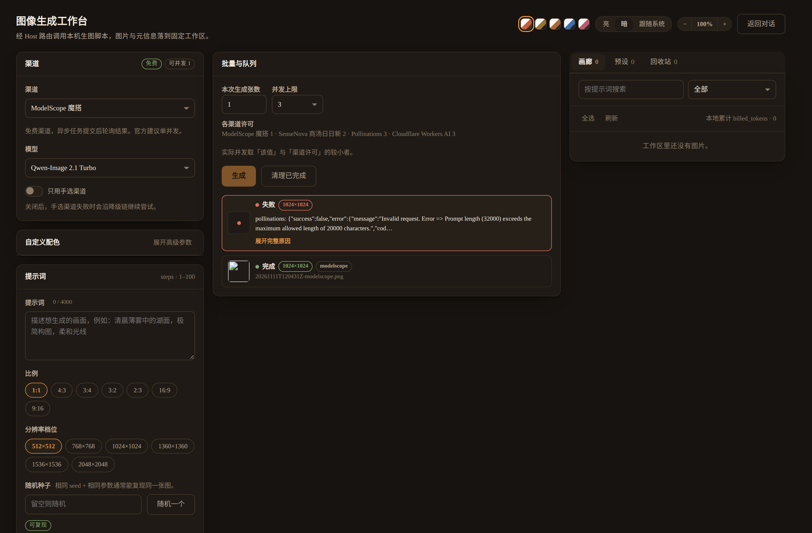
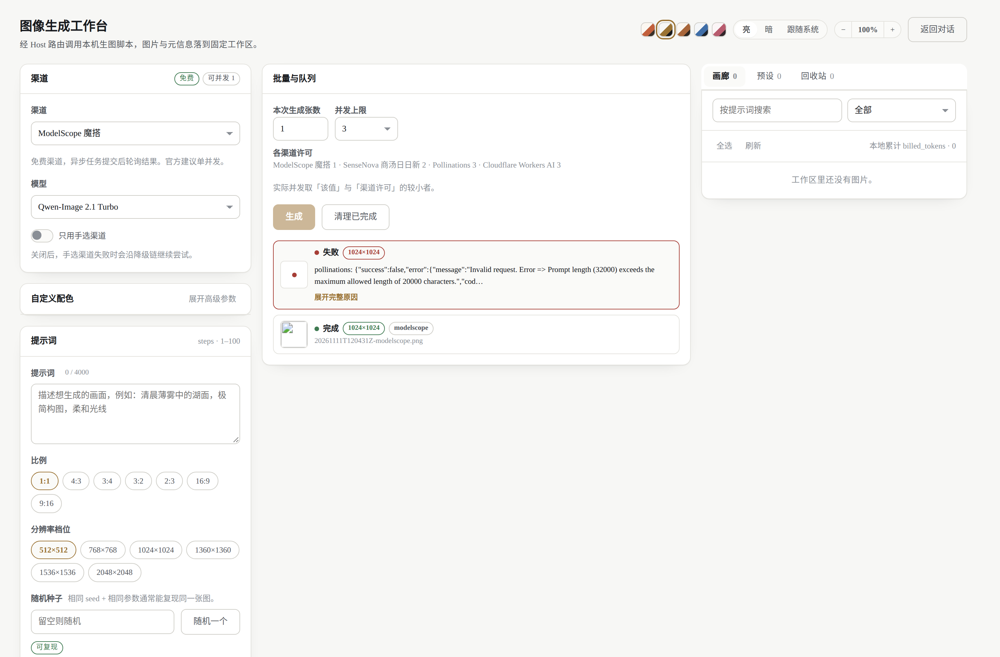
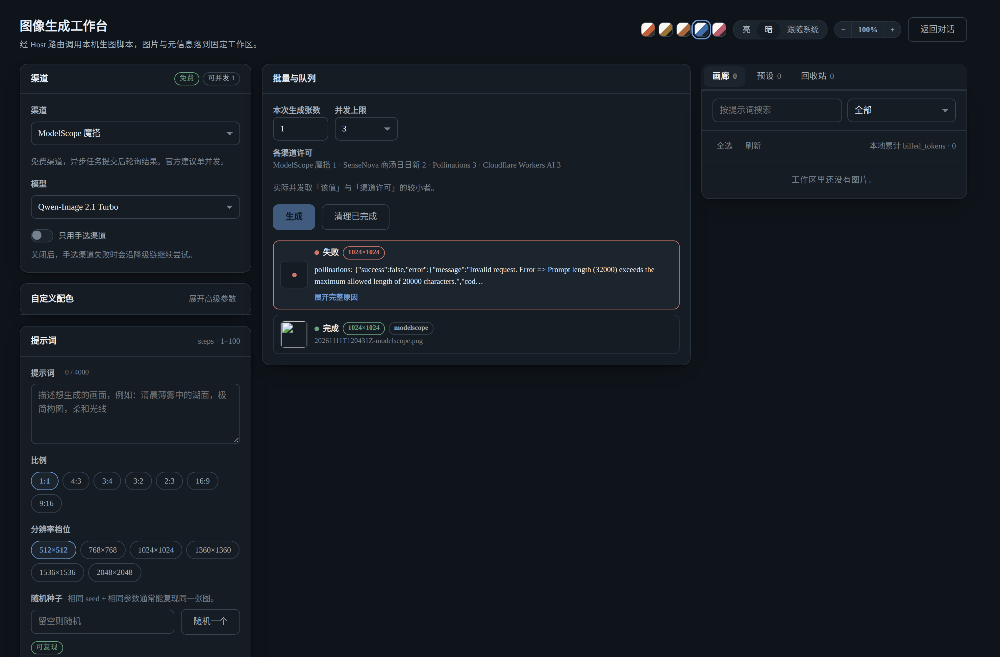
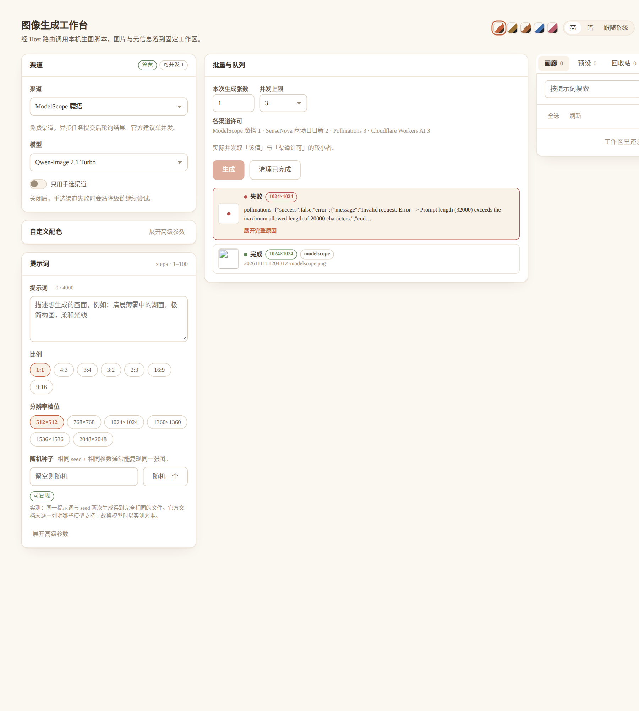

# DSH Image Workbench · 图像生成工作台

**一个为 [DeepSeek Harness](https://github.com/deepseek-ai/deepseek-harness)（DSH）Web UI 打造的生图工作台插件。**

侧边栏一个入口，主页面完成「选渠道 → 选模型 → 写提示词 → 批量排队 → 看结果 → 管画廊」的完整链路。
后端直接驱动本机 Python 生图脚本，**不需要任何云服务，不经过第三方服务器**。


<details>
<summary>更多截图：暗色 / 其它配色 / 缩放</summary>

**暖阳工作室 · 暗色**



**商业杂志 · 亮色**



**石板蓝 · 暗色**



**窄屏 70% 缩放（三栏不坍缩）**



</details>

---

## 功能

### 四渠道统一入口，自动降级

| 渠道 | 计费 | API Key | 能力 |
|---|---|---|---|
| **ModelScope 魔搭** | 免费额度 | **必填** | 中文友好、异步任务、支持 LoRA |
| **SenseNova 商汤日日新** | 按 token 计费 | **必填** | 唯一支持**参考图编辑**（最多 5 张）、可到 4096px |
| **Pollinations** | 免费额度 | **必填** | MAI Image 2.6 系列 |
| **Cloudflare Workers AI** | 免费额度 | **必填** | 最后兜底，按模型族切换参数 |

任一渠道失败自动沿降级链切换到下一个。你也可以锁定单个渠道不降级。

### 批量与队列

- 一次提交多张，Host 侧按**每渠道并发许可**排队调度
- 每个任务独立状态：排队中 / 执行中 / 完成 / 失败 / 已取消
- 失败原因**完整显示**（可展开查看供应商原始报文），不会截断
- 「清理已完成」只清显示记录，**不动你的图片文件**——删文件归画廊管

### 五套配色 + 自定义，全部带暗色

顶栏一键切换整站配色，每套都自带**专属暗色分支**（不是简单反色）：

| 配色 | 风格 |
|---|---|
| 暖阳工作室 | 米白纸感 + 赤陶 |
| 商业杂志 | 冷白 + 铜金 |
| 陶土编辑 | 暖纸底 + 陶土 |
| 石板蓝 | 中性 + 靛蓝 |
| 樱雾粉 | 浅粉 + 玫瑰 |

「自定义配色」可逐项修改 11 个语义色（页面底、卡片底、边框、正文、强调、错误等），清空某项即恢复该配色原值。

### 可缩放画布

三栏固定布局，整块画板按比例缩放（40%–200%），**窄屏时整体缩小而不是把三栏压成一栏**，竖列永远不会越拉越长。

### 提示词上限按渠道/模型分别校验

不同渠道的字符上限差异很大，且**全部经过实测**：

| 渠道 / 模型 | 上限 | 依据 |
|---|---|---|
| ModelScope | 4,000 | 实测：4000 通过，12000 被拒 |
| SenseNova | 32,000 | 实测：32000 通过，32001 被拒 |
| Pollinations | 20,000 | 实测：8000 通过，20001 被拒 |
| Cloudflare flux-1-schnell | 2,048 | 实测：2048 通过，2049 被拒 |
| Cloudflare SDXL 系 | 8,000 | 实测通过 |

界面实时显示 `当前字数 / 上限`，超限变红并禁用生成，同时说明是哪条渠道的上限。Host 侧做同样的校验，**超限请求不会真的发出去**。

### 提示词助手

- **译成英文**（免费，走 Host 匿名翻译服务）
- **润色 / 扩写**（走你配置的模型路由）

Pollinations 对中文提示词会静默返回不相干画面，界面会提前警告。

### 画廊与回收站

- 按提示词搜索、按渠道筛选
- 生成时记录的提示词 / seed / 参数可**一键回填**再生成
- 删除进回收站可恢复，清空回收站才真正删文件
- 每张图旁有可复现 sidecar（`.workbench.json`）

---

## 安装

三种方式任选其一。**装完后都要重启 DSH Web**，侧边栏才会出现入口。

### 方式 A：一句话让 AI 帮你装（最省事）

把下面这段直接发给 DSH / Claude Code / Cursor 等任意能操作终端的 AI：

```
帮我在 DeepSeek Harness 的 web profile 里安装插件 dsh-image-workbench，
仓库地址 https://github.com/1273088489/dsh-image-workbench 。

步骤：
1. cd ~/.dsh/profiles/web
2. git clone https://github.com/1273088489/dsh-image-workbench.git
3. 在该目录执行 pnpm install 装好它自己的依赖
4. 编辑 ~/.dsh/profiles/web/package.json：
   - dependencies 里加 "dsh-image-workbench": "link:./dsh-image-workbench"
   - dsh.profile.bundles 数组里追加 "dsh-image-workbench"
5. 回到 ~/.dsh/profiles/web 执行 pnpm install
6. 告诉我需要重启 dsh web 才能生效
```

> ⚠️ **第 4 步两处都要改。** 只加 `dependencies` 不往 `dsh.profile.bundles` 里加，包会被装上但**插件不会激活** —— 侧边栏什么都没有，也没有报错。这是最容易漏的一步。

### 方式 B：git clone（推荐，便于更新）

```bash
# 1. 克隆进 profile 目录
cd ~/.dsh/profiles/web
git clone https://github.com/1273088489/dsh-image-workbench.git
cd dsh-image-workbench && pnpm install && cd ..

# 2. 编辑 ~/.dsh/profiles/web/package.json，加两处：

#    "dependencies": {
#      "dsh-image-workbench": "link:./dsh-image-workbench"
#    }
#
#    "dsh": { "profile": { "bundles": [
#      ...
#      "dsh-image-workbench"
#    ] } }

# 3. 应用
pnpm install
```

更新时：

```bash
cd ~/.dsh/profiles/web/dsh-image-workbench && git pull
```

### 方式 C：从 Release 下载（不想用 git）

```bash
cd ~/.dsh/profiles/web
curl -L -o pkg.tgz \
  https://github.com/1273088489/dsh-image-workbench/releases/download/v1.0.0/dsh-image-workbench-1.0.0.tgz

mkdir dsh-image-workbench && tar -xzf pkg.tgz -C dsh-image-workbench --strip-components=1
rm pkg.tgz
```

然后按**方式 B 的第 2、3 步**修改 `package.json` 并 `pnpm install`。

> Release 里的 tgz 是 npm 打包产物，含 `index.js` / `src/` / `lib/` / `scripts/` / `backend/` / `README` / `LICENSE`，**不含** `docs/` 截图（体积考虑）。

### 验证装好了

```bash
cd ~/.dsh/profiles/web
pnpm exec dsh --profile web --dump-config | grep dsh-image-workbench
```

应当看到：

```
# == dsh-image-workbench
- id: dsh-image-workbench:workbench
  name: dsh-image-workbench
```

看到这两行说明 bundle 已被正确展开。没有输出就是没装好，回到上面检查第 2 步有没有漏改 `bundles`。

然后重启 DSH Web，侧边栏出现「图像生成工作台」。

### 前置要求

- **DSH** ≥ 0.1.0（Web UI）
- **Node.js** ≥ 20
- **Python** ≥ 3.10（只用标准库，无第三方依赖）

### 配置 API Key

**不要把密钥写进任何会被提交的文件。** 二选一：

**方式 A：环境变量（推荐）**

```bash
export MODELSCOPE_API_TOKEN="your-token"
export SENSENOVA_API_KEY="your-key"
export POLLINATIONS_API_KEY="your-key"
export CLOUDFLARE_API_TOKEN="your-token"
export CLOUDFLARE_ACCOUNT_ID="your-account-id"
```

**方式 B：`credentials.env` 文件**

复制模板再填值：

```bash
cp backend/credentials.env.example backend/credentials.env
chmod 600 backend/credentials.env
```

`credentials.env` 已在 `.gitignore` 中，**不会被提交**。文件里保留 `REPLACE_ME` 的值会被视为未配置（明确报错，不会用假值去请求）。

只填你想用的渠道即可，缺凭据的渠道在界面上会显示「缺少凭据」。

### 关于 API Key（重要）

**四个渠道全部都需要你自己的 API Key，没有一个是免注册可用的。**

仓库里**不含任何密钥**，也没有内置公共 key —— 每个使用者用自己的账号和额度。

| 渠道 | 是否花钱 | 怎么拿 key |
|---|---|---|
| ModelScope 魔搭 | 免费额度 | [modelscope.cn](https://modelscope.cn) → 账号设置 → 访问令牌 |
| Pollinations | 免费额度 | [enter.pollinations.ai](https://enter.pollinations.ai) |
| Cloudflare Workers AI | 免费额度（每日限额） | [dash.cloudflare.com](https://dash.cloudflare.com) → Workers AI → API Token + Account ID |
| SenseNova 商汤 | **按 token 计费，会真花钱** | [platform.sensenova.cn](https://platform.sensenova.cn) |

「免费额度」指的是**用你自己的免费账号不会产生费用**，不是「不用 key」。Cloudflare 还需要额外的 `CLOUDFLARE_ACCOUNT_ID`。

**只填你想用的渠道即可**，缺 key 的渠道在界面上会显示「缺少凭据」，不会被调用。SenseNova 完全留空就永远不会产生费用。

---

## 使用

1. 侧边栏点「图像生成工作台」
2. 选渠道 → 选模型（或留在「自动」走降级链）
3. 写提示词，选比例和分辨率
4. 设定本次张数，点「生成」
5. 中栏队列实时显示进度；完成后右栏画廊可看大图

### 高级参数

只对支持的模型出现，没有的参数不会显示成灰色摆件：

| 参数 | 作用 | 可用渠道 |
|---|---|---|
| 负面提示词 | 排除不想出现的特征 | ModelScope、Cloudflare SDXL 系 |
| 步数 | 去噪次数，越高细节越多但收益递减 | ModelScope、Cloudflare |
| 引导强度 | 越大越贴合提示词，过大画面僵硬 | ModelScope、Cloudflare SDXL 系 |
| LoRA | 叠加风格小模型，JSON 格式，权重和须为 1.0 | ModelScope |
| 提示词扩写 | 服务端改写提示词 | SenseNova |
| 水印 / 输出格式 | 官方水印与输出编码 | SenseNova |

> **提示词扩写提醒**：SenseNova 默认开启。实测 3 万字符的提示词开着时会被压到约 2.2K token，**关掉后才是 8.6K**。想要长提示词原样生效，请手动关掉它。

---

## 数据存放在哪

```
~/.dsh/image-gen-workspace/
├── *.png / *.jpg            生成的图片
├── *.meta.json              供应商元信息
├── *.workbench.json         可复现 sidecar（提示词/seed/参数）
├── jobs/                    任务临时文件
├── .trash/                  回收站
└── library/                 预设缩略图
```

**都是在你自己机器上，不会上传到任何地方。**

---

## 开发

```bash
# 静态检查：inject 契约、全局污染、模块形状
npm run check

# 真执行 apply()，验证组件能挂载
npm run check:apply

# 探测后端能力清单
npm run probe
```

改完代码后**必须跑前两个**。`apply()` 漏声明 `inject` 会让整个 WebUI 打不开。

### 项目结构

```
├── index.js                    Host 半侧：HTTP 路由、任务队列、并发调度
├── src/client.js               浏览器半侧：全部 UI（React）
├── lib/
│   ├── capabilities.js         渠道/模型/尺寸/上限的声明式表与校验
│   ├── prompt-assist.js        翻译、润色、扩写的指令
│   └── prompt-llm.js           模型路由解析
├── scripts/
│   ├── image_gen_bridge.py     Host ↔ Python 后端的桥
│   └── check-client-*.mjs      两道检查门
├── backend/
│   ├── free_image_gen.py       实际调用四个供应商的 Python 模块
│   ├── references/             各渠道官方文档整理（含实测记录）
│   └── SKILL.md                后端使用说明
└── locale/                     中英文文案
```

### 加一个新渠道

1. 在 `backend/free_image_gen.py` 加一个 `xxx_generate()` 并注册进 `BACKENDS`
2. 在 `lib/capabilities.js` 的 `CHANNEL_TABLE` 加一条声明
3. 在 `PROMPT_LIMITS` 加它的字符上限

浏览器不存任何渠道知识，加渠道不用改 UI。

---

## 已知限制

- 只支持 **Web** 平台（依赖 sidebar / layout / locale 服务）
- 参考图编辑仅 SenseNova 支持
- SenseNova 是付费渠道，注意成本
- 各渠道字符上限来自实测，供应商改规则后需重新校准（`backend/references/` 里有实测记录）

## 排障

| 现象 | 原因与处理 |
|---|---|
| 侧边栏没有入口 | 检查 profile `package.json` 是否声明依赖并 `pnpm install`，然后重启 DSH |
| 渠道显示「缺少凭据」 | 对应环境变量或 `credentials.env` 没配 |
| 「未能读取生图脚本的能力清单」 | Python 模块路径不对，设 `IMAGE_GEN_HUB_SCRIPTS` 指到 `backend/` |
| 生成失败但没原因 | 升级到最新版；失败原因现在会完整显示并可展开原始报文 |
| 整个 WebUI 打不开 | 常见于 `apply()` 漏声明 `inject`，跑 `npm run check` |

---

## 许可

MIT，见 [LICENSE](LICENSE)。

## 致谢

后端整合了 ModelScope、SenseNova、Pollinations、Cloudflare Workers AI 四个平台。
各平台的接口参数与限制整理在 `backend/references/`，其中标注了实测结论——**供应商文档常有出入，实测为准**。
